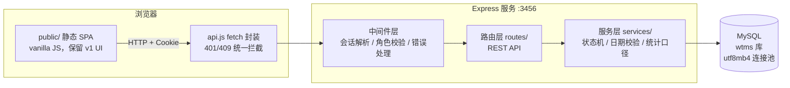
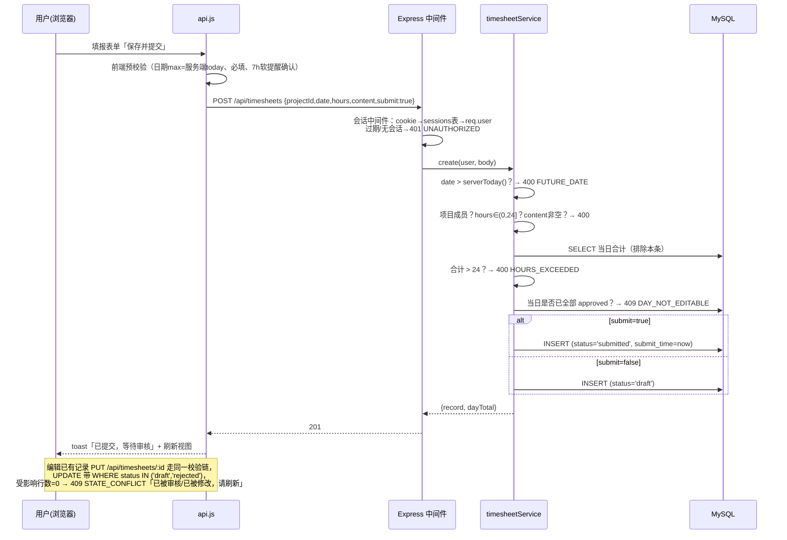
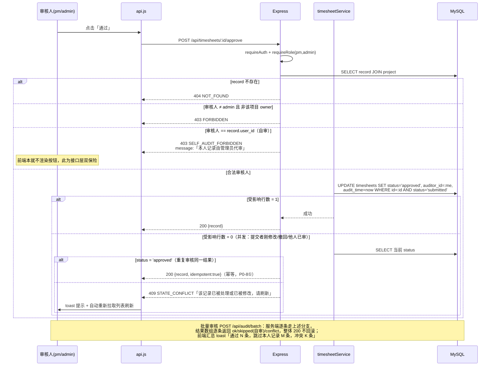

# 研发团队工时管理系统 · 架构设计 v2

| 项目 | 内容 |
|---|---|
| 文档版本 | v2.0 |
| 撰写人 | 高见远（系统架构师） |
| 撰写日期 | 2026-09-03 |
| 基线 | v1 单文件 SPA（legacy/v1-index.html，1618 行，纯前端 + localStorage） |
| 输入 | docs/PRD-increment-v2.md（增量 PRD） |
| 部署形态 | 内网单机，`npm start` 长期运行，http://localhost:端口 交付 |

---

## 0. 已拍板决策（来自产品评审）

| # | 决策 | 对设计的影响 |
|---|---|---|
| Q1 | 会话 8 小时 | 滚动过期（每次请求续期），存 sessions 表 |
| Q2 | 演示账号保留 + 首登强制改密 | users.must_change_password 字段；实现成本低（约 30 行），**保留在本版（P1 任务内实现，不降级）** |
| Q3 | 当天允许填报 | 日期校验规则为 `date > today` 才拒绝 |
| Q4 | 仅禁止审核人=提交者本人 | 单条 403，批量逐条 skip |
| Q5 | PM 本人记录由管理员代审 | admin 可访问审核视图（全量），无需新角色 |
| Q7 | 前端不读 localStorage，后端重种演示数据 | v1 旧数据静默清理，不迁移 |
| Q8 | 密码最短 8 位 | 服务端创建/重置/改密统一校验 |

---

## 1. 实现方案与总体架构

### 1.1 架构分层



要点：

- **前后端分离但同源部署**：Express 同时承担静态资源服务（`public/`）与 API（`/api/*`），单进程、单端口，无需 CORS 配置。
- **业务规则全部收口在服务层**（services/timesheetService.js）：状态机、日期校验（服务器时间）、24h 硬校验、自审拦截。前端校验仅为体验优化（提前拦截、减少请求），**不作为安全边界**。
- **统计口径单点**（services/statsService.js）：页面渲染与 Excel 导出共用同一查询，杜绝口径漂移。
- **会话持久化在 MySQL**：服务重启不掉线（US-D4 的延续体验），自实现 token 会话表（理由见 §1.3）。

### 1.2 目录结构（完整文件清单）

```
工时管理系统/
├── package.json                 # 依赖与 npm scripts（start / seed:reset）
├── server.js                    # 入口：Express 装配、静态资源、启动监听
├── .gitignore                   # node_modules/ data/
├── data/
│   └── data/backups/          # mysqldump 备份（gitignore，crontab 每日执行 scripts/backup.sh）
├── src/
│   ├── config.js                # 端口、会话时长(8h)、TZ、锁定策略(5次/10分钟)、密码最短长度
│   ├── db.js                    # MySQL 连接池(mysql2)、薄封装(prepare/exec/transaction)、schema 见 scripts/init.sql
│   ├── seed.js                  # 演示数据种子（scrypt 哈希口令；--reset 可清库重种）
│   ├── middleware/
│   │   ├── auth.js              # cookie 解析→sessions 表→req.user；requireAuth / requireRole
│   │   └── errorHandler.js      # 统一错误响应 {error:{code,message}}；404 兜底
│   ├── routes/
│   │   ├── auth.js              # 登录/登出/me/修改密码
│   │   ├── departments.js       # 部门 CRUD（admin 写，全员读）
│   │   ├── projects.js          # 项目 CRUD + /mine（admin 写，全员读）
│   │   ├── users.js             # 人员 CRUD + 重置密码（admin）
│   │   ├── timesheets.js        # 工时 CRUD/提交/日汇总/月度视图/全部工时
│   │   ├── audit.js             # 审核列表/单条通过/退回/批量审核
│   │   └── stats.js             # 按项目统计矩阵（渲染与导出共用）
│   ├── services/
│   │   ├── timesheetService.js  # 状态机 transit()、日期校验、24h 校验、dayEditable
│   │   └── statsService.js      # 统计矩阵计算（排除未来日期、异常记录单列）
│   └── utils/
│       ├── date.js              # serverToday()（服务器时区）、日期比较/格式化
│       ├── password.js          # scrypt hash/verify、失败计数、锁定判断
│       └── http.js              # ApiError 类、错误码常量
├── public/
│   ├── index.html               # 页面外壳（v1 结构迁移，引用本地资源，去掉 CDN）
│   ├── css/
│   │   └── style.css            # v1 样式原样提取
│   ├── vendor/
│   │   └── xlsx.full.min.js     # SheetJS 本地化（从 node_modules 复制，内网无 CDN）
│   └── js/
│       ├── util.js              # 日期/格式化工具；today 取自服务端 /api/auth/me，不再用本地时钟
│       ├── ui.js                # toast / openModal / uiConfirm / uiPrompt（v1 原样迁移）
│       ├── api.js               # fetch 封装：JSON、同源 Cookie、401 过期拦截、409 冲突提示
│       ├── app.js               # 入口：state、render、导航、登录页、退出
│       ├── views-fill.js        # 填报工时页 + 我的记录列表 + 记录编辑弹窗
│       ├── views-monthly.js     # 我的月度工时 + 日编辑弹窗（未来列不渲染、今天高亮）
│       ├── views-audit.js       # 工时审核页（自审无按钮、批量 skip 提示、409 自动刷新）
│       └── views-admin.js       # 基础数据管理 + 全部工时信息 + 按项目统计 + Excel 导出
├── scripts/
│   ├── init.sql                 # MySQL 建库/建用户/建表 DDL + 演示数据（部署首步执行）
│   └── backup.sh                # P1-4：每日 mysqldump 备份（保留 30 份）
└── docs/
    ├── PRD-increment-v2.md
    ├── architecture-v2.md       # 本文档
    └── deploy.md                # P0-9：部署说明（任务 T21 产出）
```

**v1 → v2 前端迁移策略**：v1 的 UI 渲染函数、样式、交互逻辑**逐文件搬运**，只替换数据访问层——`db.timesheets.filter(...)` 改为 `await api.get(...)`，`transit()`、`saveDB()` 改为调用后端接口。UI 结构零改动，回归风险最小。

### 1.3 关键技术决策

| 决策点 | 选择 | 理由 |
|---|---|---|
| 数据库引擎 | **MySQL 8.0+（mysql2 连接池，最终选型）** | 内网单机部署标准化；mysql2 连接池复用 + AsyncLocalStorage 单连接事务，utf8mb4；建库/建表/种子见 scripts/init.sql，db.js 薄封装隔离驱动差异（prepare/exec/transaction 语义对齐，service 层零改动）。（早期评估过 better-sqlite3 / node:sqlite，最终统一为 MySQL。） |
| 密码哈希 | **node:crypto scrypt**（N=16384, r=8, p=1, keylen=64） | 零原生依赖（规避 bcrypt 编译风险）；强度满足内网系统基线 |
| 会话 | **自实现 token 会话表 + HttpOnly Cookie** | 比 express-session 少一个依赖；会话落库 → **服务重启不掉线**；8h 滚动过期、登出 DELETE 即失效，均为几行 SQL；无跨设备/CSRF 高危面（内网 + SameSite=Lax） |
| 前端 | **无构建 vanilla JS + 本地静态文件** | 沿用 v1，保留全部已通过 QA 的 UI 代码；SheetJS 从 CDN 改为本地 vendor（内网无外网 CDN） |
| Excel 导出 | P0：后端统计数据接口 + 前端本地 SheetJS 生成；P1：后端 exceljs 生成流式下载 | P0 保证功能不回退且数据同源；P1 收口权限与性能。注：npm 版 xlsx 停在 0.18.5（已知 CVE-2023-30533 为**解析**侧漏洞，我们仅**生成**，内网风险可接受；P1 换 exceljs 后彻底规避） |
| 时区 | 启动时强制 `TZ=Asia/Shanghai`（config.js 中 `process.env.TZ ||= 'Asia/Shanghai'`，须在任何 Date 使用前执行） | 服务器日期是"未来日期"校验的唯一基准，必须确定性 |

---

## 2. 数据库设计

### 2.1 建表 SQL（权威版本见 scripts/init.sql，MySQL 8.0 InnoDB + utf8mb4；下表为设计视图，字段与约束保持一致）

```sql
-- 部门
CREATE TABLE IF NOT EXISTS departments (
  id   INTEGER PRIMARY KEY AUTOINCREMENT,
  name TEXT NOT NULL UNIQUE
);

-- 人员
CREATE TABLE IF NOT EXISTS users (
  id                  INTEGER PRIMARY KEY AUTOINCREMENT,
  username            TEXT NOT NULL UNIQUE COLLATE NOCASE,   -- 登录名，大小写不敏感唯一
  password_hash       TEXT NOT NULL,                          -- 格式见 §2.2
  name                TEXT NOT NULL,                          -- 真实姓名
  role                TEXT NOT NULL CHECK (role IN ('admin','pm','dev')),
  dept_id             INTEGER REFERENCES departments(id),
  must_change_password INTEGER NOT NULL DEFAULT 0,            -- 1=首登/重置后强制改密
  failed_attempts     INTEGER NOT NULL DEFAULT 0,             -- 连续失败计数
  locked_until        INTEGER,                                -- 锁定截止（epoch ms），NULL=未锁
  created_at          TEXT NOT NULL                           -- 'YYYY-MM-DD HH:mm' 服务器本地时间
);

-- 项目
CREATE TABLE IF NOT EXISTS projects (
  id         INTEGER PRIMARY KEY AUTOINCREMENT,
  name       TEXT NOT NULL UNIQUE,
  owner_id   INTEGER NOT NULL REFERENCES users(id),           -- 负责人（pm）
  created_at TEXT NOT NULL
);

-- 项目成员（v1 的 memberIds 数组归一化为关联表）
CREATE TABLE IF NOT EXISTS project_members (
  project_id INTEGER NOT NULL REFERENCES projects(id) ON DELETE CASCADE,
  user_id    INTEGER NOT NULL REFERENCES users(id)    ON DELETE CASCADE,
  PRIMARY KEY (project_id, user_id)
);

-- 工时记录
CREATE TABLE IF NOT EXISTS timesheets (
  id            INTEGER PRIMARY KEY AUTOINCREMENT,
  user_id       INTEGER NOT NULL REFERENCES users(id),         -- 提交者
  dept_id       INTEGER REFERENCES departments(id),            -- 创建时快照（统计展示用，v1 口径）
  project_id    INTEGER NOT NULL REFERENCES projects(id),
  date          TEXT NOT NULL,                                 -- 'YYYY-MM-DD'，CHECK 由服务层保证
  hours         REAL NOT NULL CHECK (hours > 0 AND hours <= 24),
  content       TEXT NOT NULL,
  status        TEXT NOT NULL DEFAULT 'draft'
                CHECK (status IN ('draft','submitted','approved','rejected')),
  submit_time   TEXT,                                          -- 'YYYY-MM-DD HH:mm'，NULL=未提交
  audit_time    TEXT,                                          -- 最后一次审核动作时间
  auditor_id    INTEGER REFERENCES users(id),                  -- 审核人（P1-3 留痕）
  audit_comment TEXT NOT NULL DEFAULT '',                      -- 退回意见
  created_at    TEXT NOT NULL,
  updated_at    TEXT NOT NULL
);
CREATE INDEX IF NOT EXISTS idx_ts_user_date    ON timesheets(user_id, date);
CREATE INDEX IF NOT EXISTS idx_ts_project_date ON timesheets(project_id, date);
CREATE INDEX IF NOT EXISTS idx_ts_status       ON timesheets(status);

-- 会话（自实现，token 随机 32 字节 hex）
CREATE TABLE IF NOT EXISTS sessions (
  token          TEXT PRIMARY KEY,
  user_id        INTEGER NOT NULL REFERENCES users(id) ON DELETE CASCADE,
  created_at     INTEGER NOT NULL,     -- epoch ms
  last_active_at INTEGER NOT NULL,     -- epoch ms（滚动续期）
  expires_at     INTEGER NOT NULL      -- epoch ms，= last_active_at + 8h
);
CREATE INDEX IF NOT EXISTS idx_sessions_expires ON sessions(expires_at);

-- 元信息（种子标识、schema 版本）
CREATE TABLE IF NOT EXISTS app_meta (
  key   TEXT PRIMARY KEY,
  value TEXT NOT NULL
);
```

设计说明：

- **业务时间戳**（submit_time/audit_time/created_at）统一存服务器本地时间字符串 `'YYYY-MM-DD HH:mm'`，与 v1 展示格式一致，前端零转换；**会话时间**用 epoch ms 整数便于比较。两类混用是有意取舍（展示 vs 计算），已在字段注释标明。
- **无 version 列**：并发控制走"状态机条件更新"（`UPDATE ... WHERE status='submitted'`，受影响行数为 0 即冲突返回 409），足够覆盖 P0-8 场景，比乐观锁版本号更贴合 v1 的 transit() 语义。
- **dept_id 快照**：保留 v1 口径（工时记录上的部门是填报时所属部门，人员 later 调部门不影响历史统计）。
- **外键约束**：MySQL InnoDB 引擎默认强制外键；建表见 scripts/init.sql（ON DELETE CASCADE 已声明），无需运行时 PRAGMA 开关。

### 2.2 密码哈希字段格式

```
scrypt$<N>$<r>$<p>$<saltHex>$<hashHex>
示例: scrypt$16384$8$1$9a3f...c1$8b02...e9
```

- 盐：`crypto.randomBytes(16)`，每用户独立；哈希长度 64 字节。
- 校验：`crypto.timingSafeEqual` 常量时间比较。
- 新建/重置/用户自改密码均要求**最短 8 位**（Q8），无复杂度要求。

### 2.3 演示数据种子（src/seed.js）

- **触发时机**：server.js 启动时检测 `users` 表为空 → 自动执行种子；`app_meta.seeded_at` 记录时间。
- **内容**：迁移 v1 `seedData()` 逻辑——3 部门（研发一部/二部/测试部）、9 人（admin + pm1/pm2 + dev1~dev6，演示密码统一 **`12345678`**，满足最短 8 位）、2 项目（电商平台 owner=pm1、AI中台 owner=pm2，成员归属同 v1）、当月前 3 天工时样本（覆盖 draft/submitted/approved/rejected 四种状态、7h 正常与 ≠7h 警示样本，日期只到今天，不产生未来日期脏数据）。
- **P1-5 清空入口**：`npm run seed:reset`（--reset 删库重种）+ 管理员界面"清空演示工时"按钮（保留组织架构，二次确认）。
- Q2：种子账号 `must_change_password = 1`，首登强制改密。

---

## 3. REST API 设计

### 3.0 通用约定（详见 §7）

- 所有响应 `Content-Type: application/json`（文件下载除外）。
- 错误响应统一格式：`{ "error": { "code": "FUTURE_DATE", "message": "工时日期不能晚于今天（2026-09-03）" } }`。
- 鉴权：`wtms_session` HttpOnly Cookie；未登录访问业务接口 → 401 `UNAUTHORIZED`。

### 3.1 接口清单

#### 认证与会话

| # | 方法 | 路径 | 入参 | 出参(200) | 权限 | 错误码 |
|---|---|---|---|---|---|---|
| 1 | POST | /api/auth/login | `{username, password}` | `{user:{id,username,name,role,deptId,deptName,mustChangePassword}}` + Set-Cookie | 公开 | 401 INVALID_CREDENTIALS；423 ACCOUNT_LOCKED（附剩余分钟） |
| 2 | POST | /api/auth/logout | — | `{ok:true}`（DELETE 会话行） | 已登录 | 401 |
| 3 | GET | /api/auth/me | — | `{user, today:'YYYY-MM-DD', serverTime}`。**today 是前端渲染的唯一日期基准** | 已登录 | 401 |
| 4 | PUT | /api/auth/password | `{oldPassword, newPassword}` | `{ok:true}`（成功后 must_change_password 置 0，其他会话不强制失效） | 已登录 | 400 WEAK_PASSWORD / WRONG_OLD_PASSWORD（400） |

#### 部门（读：全员；写：admin）

| # | 方法 | 路径 | 入参 | 出参(200) | 权限 | 错误码 |
|---|---|---|---|---|---|---|
| 5 | GET | /api/departments | — | `[{id,name,userCount}]` | 已登录 | 401 |
| 6 | POST | /api/departments | `{name}` | `{id,name}` | admin | 400 VALIDATION_ERROR / DUPLICATE_NAME |
| 7 | PUT | /api/departments/:id | `{name}` | `{ok:true}` | admin | 404 NOT_FOUND；400 DUPLICATE_NAME |
| 8 | DELETE | /api/departments/:id | — | 204 | admin | 409 REFERENCED（部门下有人员或存在关联工时） |

#### 项目（读：全员；写：admin）

| # | 方法 | 路径 | 入参 | 出参(200) | 权限 | 错误码 |
|---|---|---|---|---|---|---|
| 9 | GET | /api/projects | — | `[{id,name,ownerId,ownerName,memberIds,memberNames,timesheetCount}]` | 已登录 | 401 |
| 10 | GET | /api/projects/mine | — | 当前用户为成员的项目数组 | 已登录 | 401 |
| 11 | POST | /api/projects | `{name, ownerId, memberIds[]}` | `{id,...}`；owner 自动并入成员 | admin | 400 VALIDATION_ERROR / DUPLICATE_NAME |
| 12 | PUT | /api/projects/:id | 同上 | `{ok:true}` | admin | 404；400 DUPLICATE_NAME |
| 13 | DELETE | /api/projects/:id | — | 204 | admin | 409 REFERENCED（存在关联工时） |

#### 人员（admin）

| # | 方法 | 路径 | 入参 | 出参(200) | 权限 | 错误码 |
|---|---|---|---|---|---|---|
| 14 | GET | /api/users | — | `[{id,username,name,role,deptId,deptName,mustChangePassword}]` | admin | 401/403 |
| 15 | POST | /api/users | `{name,username,password,role,deptId}` | `{id,...}`；新账号 must_change_password=1 | admin | 400 DUPLICATE_USERNAME / WEAK_PASSWORD / VALIDATION_ERROR |
| 16 | PUT | /api/users/:id | `{name,username,role,deptId}` | `{ok:true}`；不允许将自己从 admin 降级（防锁死） | admin | 404；400 DUPLICATE_USERNAME |
| 17 | PUT | /api/users/:id/password | `{newPassword}` | `{ok:true}`（管理员重置，must_change_password=1，该用户全部会话失效） | admin | 400 WEAK_PASSWORD |

#### 工时（核心）

| # | 方法 | 路径 | 入参 | 出参(200) | 权限 | 错误码 |
|---|---|---|---|---|---|---|
| 18 | GET | /api/timesheets | `?projectId&status&from&to&limit&offset` | 本人记录 `[{id,projectId,projectName,date,hours,content,status,submitTime,auditTime,auditComment}]`，按日期倒序；**分页关闭时返回裸数组** | 已登录（自动限定本人） | 401；400 VALIDATION_ERROR（`limit` 非 1~1000 整数 / `offset` 非 ≥0 整数） |
| 19 | GET | /api/timesheets/all | `?deptId&projectId&userId&from&to&status` | 全量记录（含 userName、deptName） | admin | 401/403 |
| 20 | GET | /api/timesheets/day-summary | `?date=YYYY-MM-DD` | `{date, total, editable, future}`；editable=当日无记录或有任一非 approved 记录 | 已登录 | 401 |
| 21 | POST | /api/timesheets | `{projectId, date, hours, content, submit?:bool}` | 201 `{record, dayTotal}`；submit=true 时直接落为 submitted | 已登录且为项目成员 | 401；403 NOT_MEMBER；**400 FUTURE_DATE（date > 服务器今天）**；400 VALIDATION_ERROR（hours≤0 或 >24、content 空、日期格式非法）；400 HOURS_EXCEEDED（当日合计 >24）；409 DAY_NOT_EDITABLE（当日已全部通过不可新增） |
| 22 | PUT | /api/timesheets/:id | 同 21 | `{record, dayTotal}` | 本人（admin 不可代改，保持责任边界） | 404；**409 STATE_CONFLICT（status ∉ {draft, rejected}，如已被审核/他人并发修改）**；其余同 21 |
| 23 | DELETE | /api/timesheets/:id | — | 204 | 本人 | 404；409 STATE_CONFLICT（仅 draft/rejected 可删） |
| 24 | POST | /api/timesheets/:id/submit | — | `{record}`；幂等：已 submitted → 200 直接返回 | 本人 | 404；409 STATE_CONFLICT（approved 状态） |

> **分页（18 号接口，可选）**：`limit` 须为 1~1000 的整数、`offset` 须为 ≥0 的整数，非法值（0、>1000、小数、非数字、负数）返回 400 `VALIDATION_ERROR`。**不传即不分页**，行为与旧版完全一致（响应始终为裸数组，不包 envelope）；仅当 `limit > 0` 时以参数化占位符追加 ` LIMIT ? OFFSET ?`。权限不变：`requireAuth` 且 SQL 恒定 `t.user_id = ?` 强制本人，不接受 `userId` 等越权参数。前端「工时记录列表」导出按每批 500 条调用该接口分批拉取。

#### 月度视图

| # | 方法 | 路径 | 入参 | 出参(200) | 权限 | 错误码 |
|---|---|---|---|---|---|---|
| 25 | GET | /api/timesheets/monthly | `?month=YYYY-MM` | `{month, today, projects:[{id,name}], records:[...含 projectName、status]}`。前端据 today 只渲染 ≤today 的列；date>today 的记录（历史脏数据）附带 `anomaly:true` 标记，前端置灰、不计合计 | 已登录 | 401；400 VALIDATION_ERROR（month 格式） |

#### 审核

| # | 方法 | 路径 | 入参 | 出参(200) | 权限 | 错误码 |
|---|---|---|---|---|---|---|
| 26 | GET | /api/audit/list | `?projectId&userId&from&to&status` | `[{record...含 userName/deptName/projectName, selfSubmitted:bool, canAudit:bool}]`。pm=自己负责的项目；admin=全量（含 PM 本人提交的待审记录，前端打"待代审"标签） | pm / admin | 401/403 |
| 27 | POST | /api/timesheets/:id/approve | — | `{record}`；**幂等：已是 approved → 200 `{record, idempotent:true}`**（P0-8①） | 项目 owner(pm) 或 admin | 404；**403 SELF_AUDIT_FORBIDDEN（审核人==提交者，message 提示"由管理员代审"）**；403 FORBIDDEN（非该项目 PM 且非 admin）；**409 STATE_CONFLICT（已退回/提交者刚修改重提，提示刷新）** |
| 28 | POST | /api/timesheets/:id/reject | `{comment}` | `{record}`；幂等：已是 rejected 且意见相同 → 200 | 同 27 | 400 COMMENT_REQUIRED；其余同 27 |
| 29 | POST | /api/audit/batch | `{ids:[], action:'approve'\|'reject', comment?}` | 200 `{results:[{id, result:'ok'\|'skipped'\|'conflict'\|'not_found', reason?}], summary:{ok:n, skipped:n, conflict:n}}`。**逐条独立处理、不整体回滚**；selfSubmitted → skipped（reason:'本人记录，由管理员代审'） | pm / admin | 401/403；400 VALIDATION_ERROR（action 非法 / reject 无 comment） |

#### 统计与导出

| # | 方法 | 路径 | 入参 | 出参(200) | 权限 | 错误码 |
|---|---|---|---|---|---|---|
| 30 | GET | /api/stats/project | `?projectId&month=YYYY-MM&scope=all\|approved` | `{month, today, memberRows:[{userId,name,dept,cells:[],sum}], totals:[], grand, anomalies:[未来日期脏记录]}`。**矩阵计算排除 date>today 的记录**（P0-4②：不参与合计/导出），anomalies 单列供置灰展示 | admin | 401/403；400 VALIDATION_ERROR |
| 31 | GET | /api/export/project.xlsx | 同 30 | xlsx 文件流（`Content-Disposition: attachment; filename*=UTF-8''工时统计_2026-09.xlsx`，同源 statsService，复用 30 的查询） | admin | 同 30（**P1-1，后置任务 T20**） |

### 3.2 日期校验的服务端落位（P0-3）

**唯一事实源**：`src/utils/date.js` 的 `serverToday()`，依赖启动时固定的 `TZ=Asia/Shanghai`，返回 `'YYYY-MM-DD'`。落位三处：

1. **写入侧硬校验**（timesheetService.create/update）：`if (date > serverToday()) throw ApiError(400, 'FUTURE_DATE', ...)`。对新增、补录、修改日期**一视同仁**；跨天边界天然满足——比较发生在"后端收到请求的那一刻"，23:59 填"今天"、00:01 提交时该日期已为合法过去日期。
2. **读取侧附带基准**：/api/auth/me、monthly(25)、stats(30) 响应均携带 `today`，前端**所有**日期渲染（选择器 max、月度/统计列截止、今天高亮）以此为准，不读浏览器本地时钟，杜绝客户端改时间绕过。
3. **统计/导出排除**：statsService 计算矩阵与合计时 `WHERE date <= :today`；未来日期记录进 `anomalies` 供置灰展示，不入合计、不入导出。

---

## 4. 时序图

### 4.1 工时填报提交流程（含未来日期拦截与状态冲突）



### 4.2 审核流程（含自审 403 拦截、状态冲突 409、幂等 200）



---

## 5. 任务列表（给工程师，按实现顺序）

依赖标注：`(依赖 T#)`。每个任务给出涉及文件，粒度可直接执行。

| # | 任务 | 涉及文件 | 依赖 | 说明 |
|---|---|---|---|---|
| T1 | 项目初始化：package.json（type:module、scripts）、.gitignore、npm install express mysql2 | package.json、.gitignore | — | 使用本机 node 22.22.2 / npm（禁止 -g） |
| T2 | config.js + db.js：配置项（端口 3456、8h 会话、TZ、锁定策略、密码最短 8 位、DB 连接）；MySQL 连接池（mysql2，prepare/exec/transaction 薄封装），建表 DDL 见 scripts/init.sql | src/config.js、src/db.js、scripts/init.sql | T1 | 部署首步执行 init.sql 建库建用户建表 |
| T3 | 基础工具：ApiError + 错误码常量；scrypt hash/verify + 失败计数/锁定判断；serverToday() + 日期比较/格式化（启动即设 TZ） | src/utils/http.js、password.js、date.js | T1 | 纯函数，可独立自测 |
| T4 | 种子数据：迁移 v1 seedData() 逻辑入库（演示密码 12345678、must_change_password=1、当月前 3 天样本、支持 --reset） | src/seed.js | T2, T3 | 手动 `node src/seed.js` 验证数据落库 |
| T5 | 中间件：auth.js（cookie 解析→sessions 表校验+滚动续期→req.user；requireAuth/requireRole；强制改密拦截：must_change_password=1 时仅放行 /api/auth/password）、errorHandler.js（统一错误体 + 404 兜底） | src/middleware/auth.js、errorHandler.js | T2, T3 | 过期会话惰性删除：请求时顺手 DELETE 过期行 |
| T6 | 认证路由：login（失败计数/锁定/423）、logout、me（含 today）、password（改密+清 must_change 标记） | src/routes/auth.js | T5 | curl 自测四接口 |
| T7 | server.js 装配 + 前端骨架迁移：静态服务 public/、路由挂载、启动日志；从 index.html 原样提取 style.css / ui.js / util.js；index.html 改本地引用（去 CDN） | server.js、public/index.html、css/style.css、js/ui.js、js/util.js | T6 | 此步后 http://localhost:3456 可出登录页（无数据） |
| T8 | 前端 API 层 + 登录闭环：api.js（fetch 封装、401 统一「登录已过期」弹窗+跳登录、409 提示+刷新当前视图、sessionStorage 记录 view 供回跳）；app.js 改造登录页（调真接口、mustChangePassword 弹改密框） | public/js/api.js、app.js | T7 | 验收：登录→me→登出→401 拦截 |
| T9 | 基础数据路由：departments / projects / users 全套 CRUD（含重置密码、引用删除拦截 409） | src/routes/departments.js、projects.js、users.js | T5 | curl 逐接口过一遍错误码 |
| T10 | 工时服务层：状态机 transit()（迁移 v1 语义到 SQL 条件更新）、create/update 校验链（FUTURE_DATE/NOT_MEMBER/HOURS_EXCEEDED/DAY_NOT_EDITABLE/STATE_CONFLICT）、daySummary | src/services/timesheetService.js | T3, T5 | 单元自测：未来日期、>24h、重复审核路径 |
| T11 | 工时路由：18~25 号接口（CRUD/提交/日汇总/月度视图/全部工时） | src/routes/timesheets.js | T9, T10 | 月度视图响应含 today + anomaly 标记 |
| T12 | 前端填报改造：views-fill.js（填报页日期 max=服务端 today、已填合计提示调 20 号接口、7h 软提醒保留前端确认；我的列表增删改提交全部走 API、409 冲突提示自动刷新） | public/js/views-fill.js | T8, T11 | 对照 v1 交互逐项回归 |
| T13 | 前端月度视图改造：views-monthly.js（列只渲染到服务端 today、今天列头高亮、anomaly 记录置灰不入合计、日编辑弹窗走 API） | public/js/views-monthly.js | T11 | 验收 P0-4①③ |
| T14 | 审核路由：audit/list（pm 限自己项目 / admin 全量 + selfSubmitted 标记）、单条 approve/reject（403 自审、409 冲突、幂等 200）、batch（逐条结果不回滚） | src/routes/audit.js | T10 | 用 pm1 自审、dev 并发改稿两个场景自测 |
| T15 | 前端审核页改造：views-audit.js（selfSubmitted 无按钮 +「由管理员代审」标签、批量结果汇总 toast「通过 N 跳过 M 冲突 K」、409 自动刷新）；admin 导航增加审核入口 | public/js/views-audit.js、app.js | T8, T14 | 验收 P0-1、P0-2 |
| T16 | 统计服务与路由：statsService（矩阵排除未来日期、anomalies 单列）+ stats/project 接口 | src/services/statsService.js、src/routes/stats.js | T11 | 口径与 v1 statsData() 对齐 |
| T17 | 前端管理端改造：views-admin.js（基础数据三 Tab、全部工时列表、统计矩阵渲染、SheetJS 本地 vendor 导出 `项目统计_{name}_{ym}.xlsx`；安装 xlsx@0.18.5 并复制 dist 到 public/vendor/） | public/js/views-admin.js、public/vendor/xlsx.full.min.js | T8, T9, T16 | 导出数据来自 30 号接口（同源） |
| T18 | 端到端冒烟 + 持久化验证：登录→填报→提交→pm 审核（含自审 403/批量 skip）→admin 代审→统计→导出；kill 进程重启验证数据完整、会话不掉线；双浏览器并发 409 演示 | 全部 | T1~T17 | 输出冒烟清单到 docs/deploy.md 附录 |
| T19 | P1：锁定与强制改密联调（5 次失败锁 10 分钟、首登改密闭环） | src/routes/auth.js、middleware/auth.js、public/js/app.js | T18 | Q2 已拍板保留在本版 |
| T20 | P1：后端 xlsx 导出（npm i exceljs，31 号接口流式下载，复用 statsService；前端导出按钮切到后端接口，前端 SheetJS 保留为降级） | src/routes/stats.js、public/js/views-admin.js | T18 | 验收 P1-1 |
| T21 | P1：初始化脚本 + 备份脚本 + 部署文档：scripts/init.sql（建库建用户建表+演示数据）；scripts/backup.sh（每日 mysqldump 备份、保留 30 份、说明恢复步骤）；docs/deploy.md（环境依赖、启动、初始化、备份/恢复、冒烟清单） | scripts/init.sql、scripts/backup.sh、docs/deploy.md | T18 | 验收 P0-9、P1-4 |
| T22 | P1：清空演示数据入口（admin 界面二次确认 + 后端事务删除工时样本可选保留组织架构） | src/routes/timesheets.js、public/js/views-admin.js | T18 | 验收 P1-5 |

---

## 6. 依赖包列表（package.json）

```json
{
  "name": "workhour-management-system",
  "version": "2.0.0",
  "private": true,
  "type": "module",
  "scripts": {
    "start": "node server.js",
    "seed": "node src/seed.js",
    "seed:reset": "node src/seed.js --reset"
  },
  "dependencies": {
    "mysql2": "^3.24.3",
    "express": "^4.21.2"
  },
  "devDependencies": {},
  "engines": { "node": ">=22.13" }
}
```

- **express ^4.21.2**：不用 Express 5（路径参数/中间件生态变动，无收益）。
- **mysql2 ^3.24.3**：Promise 驱动 + 连接池；utf8mb4；多语句（multipleStatements）仅用于 init/迁移脚本。
- **T20 追加**：`"exceljs": "^4.4.0"`（仅 P1 后端导出任务时安装）。
- **T17 追加**：`"xlsx": "0.18.5"`（仅用于复制 dist/xlsx.full.min.js 到 public/vendor/，前端运行时零构建依赖；版本锁死，该包已停更，已知漏洞为解析侧、本系统仅生成，内网可接受）。
- 无 devDependencies（无测试框架/构建器——本项目为单人内网小系统，验收以冒烟清单为准；若后续补自动化再引入 node:test，Node 内置零依赖）。

---

## 7. 共享知识 / 团队约定

### 7.1 错误响应格式（所有非 2XX）

```json
{ "error": { "code": "STATE_CONFLICT", "message": "该记录已被审核，请刷新后重试", "details": { "currentStatus": "approved" } } }
```

`details` 可选。错误码全集（src/utils/http.js 常量，前后端共用语义）：

`UNAUTHORIZED(401)` `FORBIDDEN(403)` `SELF_AUDIT_FORBIDDEN(403)` `NOT_FOUND(404)` `STATE_CONFLICT(409)` `REFERENCED(409)` `DAY_NOT_EDITABLE(409)` `VALIDATION_ERROR(400)` `FUTURE_DATE(400)` `HOURS_EXCEEDED(400)` `NOT_MEMBER(403)` `DUPLICATE_NAME(400)` `DUPLICATE_USERNAME(400)` `WEAK_PASSWORD(400)` `WRONG_OLD_PASSWORD(400)` `COMMENT_REQUIRED(400)` `INVALID_CREDENTIALS(401)` `ACCOUNT_LOCKED(423)` `INTERNAL(500)`

### 7.2 日期与时间约定

- 业务日期一律 `YYYY-MM-DD` 字符串（MySQL VARCHAR(10)，字典序即时间序）；月份 `YYYY-MM`。
- 展示时间戳 `YYYY-MM-DD HH:mm`（服务器本地，TZ=Asia/Shanghai）。
- **前端禁止用 `new Date()` 取"今天"**，一律取 `state.today`（登录时从 /api/auth/me 同步，每小时静默刷新一次）。
- 周末判定/星期显示在前端做（纯展示逻辑，与服务端校验无关）。

### 7.3 前端 API 层封装（public/js/api.js）

```js
// 统一封装：同源 Cookie、JSON 序列化、错误归一化、401/409 全局拦截
const request = (method, path, body) => fetch(path, {
  method, credentials: 'same-origin',
  headers: body ? { 'Content-Type': 'application/json' } : {},
  body: body ? JSON.stringify(body) : undefined,
}).then(async res => {
  if (res.status === 401) { onSessionExpired(); throw new ApiErr(401, 'UNAUTHORIZED', '登录已过期'); }
  const data = res.status === 204 ? null : await res.json();
  if (!res.ok) throw new ApiErr(res.status, data.error.code, data.error.message);
  return data;
});
export const api = {
  get: p => request('GET', p), post: (p, b) => request('POST', p, b),
  put: (p, b) => request('PUT', p, b), del: p => request('DELETE', p),
};
```

- `onSessionExpired()`：toast「登录已过期」→ sessionStorage 记录当前 view 与未提交表单数据留在 DOM → 跳登录页 → 登录成功回跳原 view（P0-7①，表单内容因页面不整页刷新天然保留）。
- 409：api.js 不全局拦截，由调用方 catch 后 toast `err.message` + `renderView()` 自动刷新数据（P0-8③）。
- 所有视图函数从同步渲染改为 `async renderX(main)`，app.js 的 renderView 统一 await。

### 7.4 权限模型（中间件 + 路由内双层）

| 角色 | 数据范围 |
|---|---|
| admin | 全量读写组织数据；全量工时**只读**；全量审核权（含 PM 本人记录代审） |
| pm | 本人项目成员的工时审核权（除本人提交的）；本人工时读写 |
| dev | 本人工时读写 |

- 中间件管粗粒度（登录、角色）；行级权限在 service/路由内判定（如审核时校验"是该项目 owner 或 admin"、"记录属于本人"），判定失败一律 403，不泄露资源是否存在（列表接口天然按权限过滤，单条接口 403/404 区分不做刻意混淆——内网系统，可读性优先）。

### 7.5 v1 → v2 数据迁移说明

- v1 的 localStorage key `wtms_data`、`wtms_session`：**不读取、不迁移**（Q7 已拍板，v1 均为演示数据）。
- v2 前端首次加载时检测到旧 key → `localStorage.removeItem` 静默清理，避免用户误以为旧数据丢失是 bug。
- v1 的 `legacy/v1-index.html` 保留为历史基线（QA 64/64 记录），v2 入口为 `public/index.html`，交付时 `npm start` 后访问 http://localhost:3456。

### 7.6 安全基线

- SQL 全部参数化（mysql2 占位符 `?`），**禁止字符串拼接 SQL**。
- Cookie：`HttpOnly` + `SameSite=Lax` + `Path=/`（内网 HTTP，不加 Secure）。
- 密码 scrypt 加盐哈希；登录失败 5 次锁 10 分钟；重置密码后目标用户会话全失效。
- XSS：沿用 v1 的 `esc()` 转义所有用户输入渲染，迁移时逐处保留，不得遗漏。

---

## 8. 待明确事项

1. **端口**：默认 3456，若本机 3456 被占用，`PORT` 环境变量覆盖（config.js 已支持），交付时确认。
2. **admin 是否需要专属"待我代审"筛选视图**：本设计在审核列表中以 `selfSubmitted` 标签提示，若 PM 记录量大可加 `?pendingByAdmin=true` 过滤（低成本，待产品确认）。
3. **用户删除**：v1 无此功能，v2 维持（只有编辑/重置密码）。人员离职场景建议后续加"停用"状态，本版不做。
4. **xlsx@0.18.5 的 CVE-2023-30533**：仅影响解析侧，本系统只生成；T20（exceljs 后端导出）落地后前端 SheetJS 降级为兜底，风险自然消除。
5. **批量审核单次上限**：未设上限（内网单人操作），若出现性能问题再加 `ids.length ≤ 500` 限制。
6. **MySQL 连接**：db.js 使用连接池 + AsyncLocalStorage 单连接事务；建表 DDL 见 scripts/init.sql（部署首步执行）。本版统一 MySQL，无 SQLite 降级路径。
